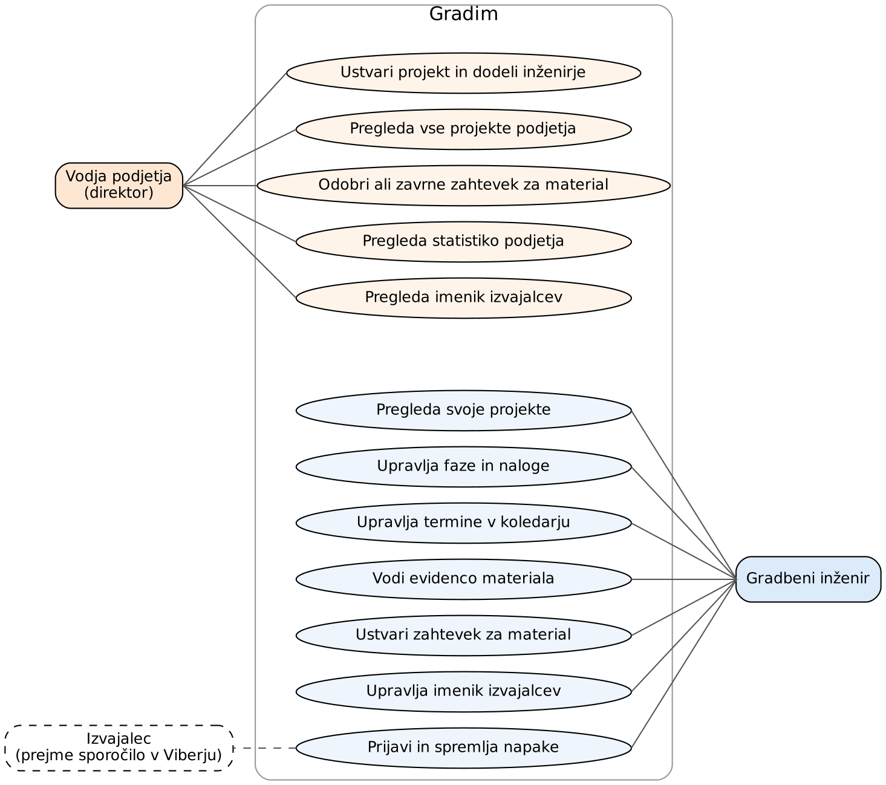

# 2. Primeri uporabe

Primeri uporabe so ločeni po akterjih, ker direktor in inženir ne delata istih stvari (direktor vidi vse projekte, inženir samo svoje). Izvajalec je sekundarni akter – prejme sporočilo o napaki v Viberju.

## Ključni scenariji

| # | Scenarij | Akter | Koraki | Zasloni |
|---|---|---|---|---|
| S1 | Nov projekt | direktor | vnese podatke in tip → doda inženirje → vnese nadstropja in stanovanja; projekt dobi 20 privzetih faz | 01 → 02 |
| S2 | Plan del | inženir | izklopi nepotrebne faze → doda nalogo: aktivnost, obseg (stavba / nadstropje / stanovanja), prostor, izvajalec, cena, rok | 03 → 04 → 05 |
| S3 | Zaključek naloge | inženir | »Označi dokončano« → po želji fotografija → »Delo pravilno?« da: zaključi, ne: prijava napake | 06 → 07 |
| S4 | **Prijava napake** | inženir | fotografija z označbo → naloga in stanovanje (izvajalec se izpolni sam) → resnost, opis, rok → »Shrani in pošlji na Viber«; ob odpravi »Označi rešeno« (fotografija neobvezna) | 10 → 11 → 13 |
| S5 | Nov termin | inženir | po klicu vnese kdo, kdaj, za katero nalogo; opomnik večer prej; na dan označi *prišel / ni prišel* | 08 → 09 |
| S6 | Zahtevek za material | inženir → direktor | »Manjka material« → količina, rok, razlog → direktor odobri ali zavrne (push obvestilo) → ob dobavi vnos v zalogo | 14 → 16 |
| S7 | Pregled podjetja | direktor | roki, čas reševanja napak, plan proti dejanskemu, napake po izvajalcih | 01 → 18 |
| S8 | Izvajalec iz kontaktov | inženir | »Izberi iz kontaktov« → sistemski imenik → ime in telefon se izpolnita → doda obrt | 17 → 19 |

Pri S8 aplikacija uporablja sistemski izbirnik kontaktov, zato ne potrebuje dovoljenja za branje vseh kontaktov – dobi samo izbrani kontakt.
