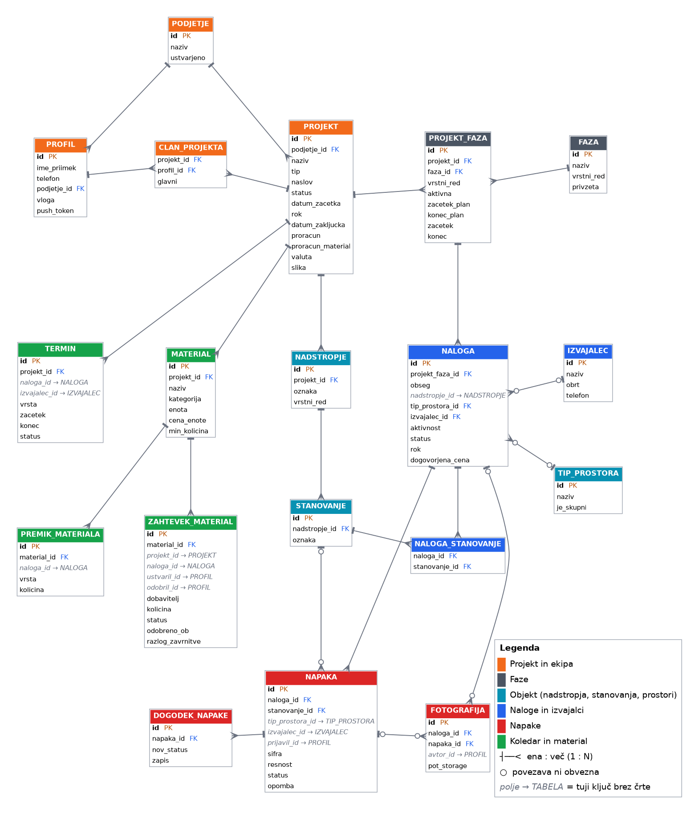

# 4. Podatkovni model

Podatki so v **Supabase (PostgreSQL)**, fotografije v Supabase Storage (v bazi je samo pot).

## Ključne odločitve

- **Podjetje** povezuje uporabnike in projekte; trenutno je naročnik eden (Aleks Stanovi), model pa omogoča več podjetij.
- **Faze:** `faza` je katalog (20 privzetih + dodane), `projekt_faza` so faze na projektu z možnostjo izklopa ter načrtovanim in dejanskim začetkom/koncem.
- **Lokacija naloge:** stavba → `nadstropje` → `stanovanje` in `tip_prostora` (kopalnica, kuhinja …, tudi skupni deli: fasada, stopnišče). Posamezne sobe ne vodimo. Naloga ima **obseg**:

| Primer | obseg | tip prostora |
|---|---|---|
| Ploščice v kopalnici stanovanja 12 | izbrana stanovanja (12) | Kopalnica |
| Ploščice v vseh kopalnicah | cela stavba | Kopalnica |
| Pleskanje dnevnih sob v 2. nadstropju | nadstropje (2.) | Dnevna soba |
| Fasada | cela stavba | Fasada |

- **Napaka** ima svoje stanovanje, zato filter »napake v stanovanju 12 / v kopalnicah« deluje tudi pri nalogi za celo stavbo. Pogled `naloga_po_stanovanju` razvije »celo stavbo« in »nadstropje« v posamezna stanovanja.
- **Zaloga materiala** se ne shranjuje, ampak izračuna iz premikov (naročilo + dokup − poraba − vračilo).
- **Pravice (RLS):** inženir vidi samo projekte, kjer je član; direktor vse projekte svojega podjetja in edini odobri zahtevke.
